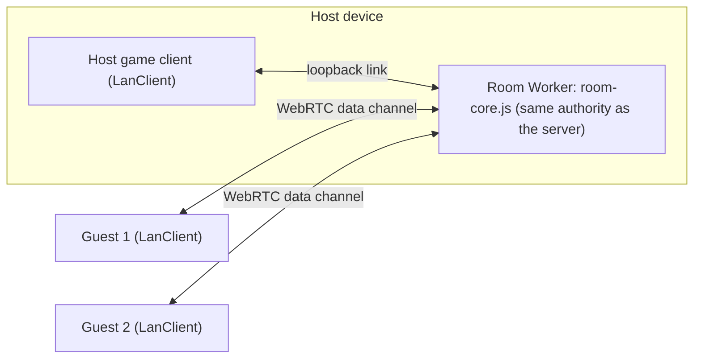

# Nearby multiplayer (offline PWA)

Friends can play together with **no internet and no server**, as long as every
device is on the same Wi-Fi network or connected to one phone's hotspot.

## How players use it

1. Every player opens the installed game (it works fully offline after the
   first visit) and chooses **Play with friends → Nearby**.
2. The host picks a victory condition and battlefield and taps **Host a nearby
   room** (or **Create custom nearby battle** for up to eight kingdoms mixing
   friends and AI).
3. In the war room the host taps **Show invite code**. A QR invite appears.
4. A friend taps **Join a nearby room** and scans the invite. Their screen then
   shows a reply QR.
5. The host taps **Scan your friend's reply**. The devices link directly, the
   friend appears in the lobby, and the host can invite the next commander.
6. Everyone marks ready and the host starts the battle.

No camera, or playing on a laptop? Every QR step also offers **Copy code /
Share** and a **paste box**, so codes can travel by any messaging app.

If a friend drops out, the match waits and their kingdom is held for two
minutes. The host opens the commander menu → **Invite or reconnect a nearby
player**, and the friend chooses **Rejoin with a new invite** and scans it. They
return to the same kingdom.

## How it works

- **One room authority.** `src/room-core.js` holds all room, validation, fog of
  war, snapshot and reconnect logic. The hosted Node server
  (`server/team-rooms.js`) wraps it with `ws`; Nearby mode runs the identical
  core in the host's browser, inside a module Worker
  (`src/local-room-worker.js`) so the simulation never stalls rendering. If
  module Workers are unavailable it runs on the page instead.
- **One client.** `src/network.js` (`LanClient`) speaks the same protocol to
  either path. A transport supplies a WebSocket-like link: a loopback for the
  host and an `RTCDataChannel` for each guest (`src/local-host.js`).
- **Serverless pairing.** `src/local-pairing.js` exchanges the WebRTC offer and
  answer as compressed (`deflate-raw` + base64url) codes rendered as QR
  (`src/qr-code.js`) and read by camera (`src/qr-scan.js`, native
  `BarcodeDetector` with a bundled jsQR fallback). Only local host candidates
  are used, so no STUN/TURN server is contacted.
- **Framing.** Snapshots can exceed data-channel message limits, so
  `src/channel-frames.js` splits long messages into ordered 16 KB chunks. Guest
  commands are capped at 24 KB, the same limit the hosted server enforces.
- **Host safety.** Guests are untrusted exactly as on the server: every command
  is validated by the room core, rate limited, and limited to the guest's own
  units and vision.
- **Wake lock.** The host and guests request a screen wake lock during Nearby
  play, because a sleeping host pauses everyone's match.

## Limits

- Everyone must share one local network. Some public, school or guest Wi-Fi
  networks isolate devices from each other; a phone hotspot is the most reliable.
- The host's device runs the whole battle. If the host closes the game, the
  match ends for everyone.
- Nearby rooms are not saved; one Nearby room runs per host device.
- Camera scanning requires the installed app or an HTTPS address. On a plain
  `http://` LAN address use the copy/paste codes.
